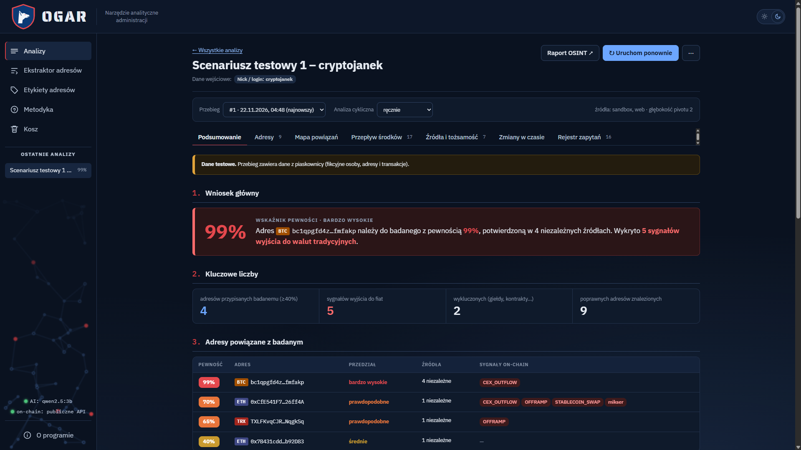
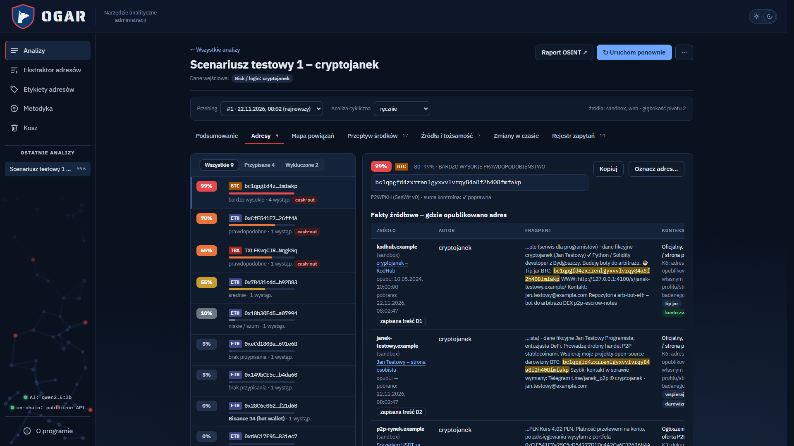
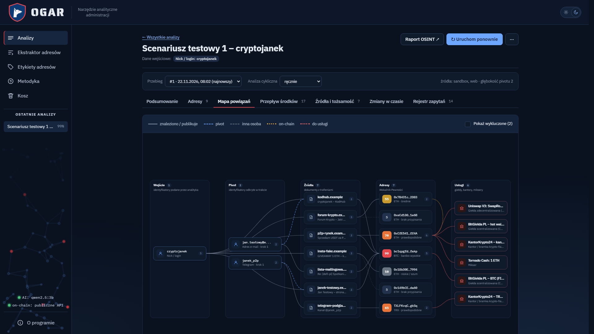
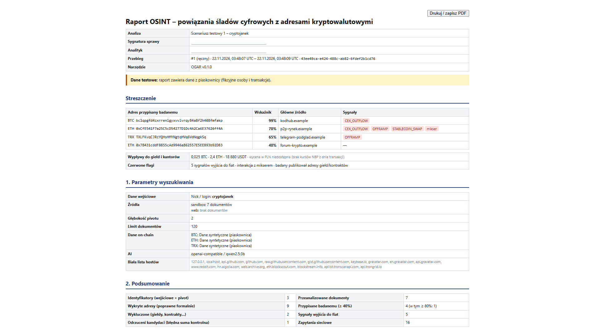

# OGAR - Narzędzie Analityczne

**HackNation 2026 · wyzwanie Ministerstwa Finansów / KAS („OSINTowy Łapacz Cyfrowych Śladów”)**

Osoby zarabiające na kryptowalutach publikują adresy portfeli na forach, w profilach, ogłoszeniach P2P i komunikatorach, ale nie wykazują przychodów w PIT-38. Analityk KAS musi dziś ręcznie przeglądać te miejsca, łączyć konta i oceniać, czy adres na pewno należy do danej osoby.

**OGAR robi to automatycznie.** Po podaniu nicku, e-maila, Telegramu, imienia i nazwiska, strony WWW albo adresu krypto:

1. **szuka śladów** w publicznych źródłach i sam podąża za nowo znalezionymi identyfikatorami (pivot),
2. **wyodrębnia adresy kryptowalut** i sprawdza ich sumy kontrolne (literówki i podróbki odpadają),
3. **ustala, kto opublikował adres**, i łączy konta badanego tylko twardymi dowodami,
4. **liczy Wskaźnik Pewności (0–99%)** według jawnych reguł, z uzasadnieniem każdego punktu,
5. **odrzuca adresy giełd, kontraktów, mikserów, zbiórek i kantorów**, ale odnotowuje interakcje z nimi,
6. **analizuje blockchain** (BTC, ETH, TRON) i wykrywa **sygnały wyjścia do walut tradycyjnych**,
7. **zapisuje przebiegi** z dowodami (URL, czas, SHA-256), **powtarza analizę cyklicznie** i **porównuje wyniki w czasie**,
8. **generuje raport OSINT**, który oddziela fakty źródłowe, wyniki obliczeń i wnioski do weryfikacji.

> Tylko publiczne źródła: bez logowania na cudze konta i bez obchodzenia zabezpieczeń. Połączenia wyłącznie z hostami z białej listy, a każde zapytanie trafia do rejestru.

**Spis treści:** [Uruchomienie](#uruchomienie) · [Scenariusze testowe](#scenariusze-testowe) · [Przykładowy wynik](#przykładowy-wynik) · [Zrzuty ekranu](#zrzuty-ekranu) · [Jak to działa](#jak-to-działa) · [Wskaźnik Pewności](#wskaźnik-pewności) · [Wykluczenia i wyjście do fiat](#wykluczenia-i-wyjście-do-fiat) · [Raport](#raport) · [Parametry wyszukiwania](#parametry-wyszukiwania) · [AI](#ai-opcjonalnie) · [Architektura i bezpieczeństwo](#architektura-i-bezpieczeństwo) · [Zgodność z wymaganiami](#zgodność-z-wymaganiami) · [Licencje](#licencje) · [Ograniczenia](#ograniczenia)

---

## Uruchomienie

Wymagany jest tylko **Node.js 22.18+** (zalecany 24) i Git. Baza danych, Docker ani klucze API nie są potrzebne.

```bash
git clone https://github.com/pilarhz/Hacknation2026-OLCS.git
cd Hacknation2026-OLCS
npm install
npm run dev
```

Otwórz **http://127.0.0.1:5173**. W tle działają też API (:8080), wbudowany PostgreSQL ([PGlite](https://pglite.dev)) i piaskownica z danymi testowymi (:4100).

**Pierwsza analiza:**
1. **Nowa analiza → Scenariusze demonstracyjne → Scenariusz 1 → Uruchom analizę.**
2. W **Podsumowaniu** zobaczysz BTC z wynikiem **99%**, 4 adresy przypisane, 2 wykluczone i 4 sygnały wyjścia do fiat.
3. Kliknij adres, żeby zobaczyć cytat ze źródła i wyliczenie wyniku reguła po regule. Kolejne zakładki to Mapa powiązań, Przepływ środków, Źródła i tożsamość oraz Rejestr zapytań.
4. **Raport OSINT ↗** otwiera raport do druku lub PDF.

**Testy:** `npm test` uruchamia 35 testów: sumy kontrolne, reguły punktacji, scenariusze 1–4 i bazę danych.

Docker, wersję produkcyjną i własny serwer PostgreSQL opisuje [docs/TECHNICZNE.md](docs/TECHNICZNE.md).

---

## Scenariusze testowe

Scenariusze 1–4 działają **wyłącznie na danych syntetycznych**. Piaskownica (`apps/sandbox`) to fikcyjny internet: forum, ogłoszenia P2P, profile, kanał Telegram, giveaway i lista mailingowa.
- E-maile są w domenie `example.com`.
- Adresy krypto mają poprawne sumy kontrolne, ale są wygenerowane z SHA-256, więc nikt nie zna do nich kluczy.
- Transakcje pochodzą z [`chain-fixtures.json`](apps/api/data/chain-fixtures.json).

Każdy scenariusz to **inna osoba, inny typ danych wejściowych i inna umiejętność narzędzia**. Uruchamia się je jednym kliknięciem w **Nowa analiza**.

| # | Wejście | Co sprawdza | Oczekiwany wynik |
|---|---|---|---|
| 1 | nick `cryptojanek` | pełna ścieżka: profil → strona WWW → ogłoszenie P2P → Telegram → lista mailingowa | 5 kont połączonych w jedną osobę · BTC **99%** (synergia 4 źródeł) · ETH z ogłoszenia **70%** (giełda, kantor, mikser) · TRON **65%** · forum **55%** · giveaway **10%** · Binance i kontrakt USDT **0%** · adres innej osoby bez przypisania · literówka odrzucona |
| 2 | nick `nowak_btc` | fałszywe trafienia | adres giełdy i zbiórki **0%**, żaden adres powyżej 50% |
| 3 | adres TRON `TUif3i…nCT9` | od adresu do osoby (wyszukiwanie odwrotne) | odkryta autorka `ola_wymiana`, jej kanał i drugi adres, oba **55%** (kara R10) · wypłaty na kartę krypto-fiat · autor ostrzeżenia „scam” **nie** jest właścicielem |
| 4 | URL profilu `marek_dev`, analiza co 1 min | zmiany w czasie | po kliknięciu „Przełącz na okres 2” w piaskownicy (:4100) zakładka **Zmiany w czasie** pokaże podmianę adresu i nowy sygnał wpłaty na giełdę |
| 5 | adres BTC zbiórki rządu Ukrainy | prawdziwe API (Hacker News, Esplora) | dokumenty z HN, wykluczenie jako zbiórka |

> Scenariusze 1–4 dowodzą spójności logiki na zaprojektowanych przez nas danych, a nie skuteczności w prawdziwym internecie (patrz [Ograniczenia](#ograniczenia)).

---

## Zrzuty ekranu

| Podsumowanie analizy | Szczegóły adresu i wyliczenie wyniku |
|---|---|
|  |  |
| **Mapa powiązań** | **Raport OSINT** |
|  |  |

---

## Jak to działa

```
 identyfikatory wejściowe ──▶ źródła Web2 ──▶ dokumenty (URL, autor, czas, SHA-256)
          ▲                                          │
          └──── nowe identyfikatory (pivot) ◀────────┤
                                                     ▼
                      adresy + sumy kontrolne ──▶ kto opublikował? w jakim kontekście?
                                                     │
                      etykiety + blockchain ◀────────┘
                                │
                                ▼
          Wskaźnik Pewności → przepływ środków → wnioski → raport / JSON / CSV
```

- **Pivot.** Identyfikatory znalezione w dokumentach **należących do badanego** (e-mail, `t.me/…`, telefon, link do profilu) są wyszukiwane w kolejnym kroku. Przy wejściu typu adres autor publikacji staje się nowym tropem, chyba że ostrzega przed adresem („scam”). Strony z nieznanych hostów pobierane są dopiero po zatwierdzeniu przez analityka.
- **Wyodrębnianie adresów.** Każdy kandydat przechodzi kontrolę sumy kontrolnej:
  - Base58Check: BTC, LTC, DOGE, TRON,
  - Bech32 i Bech32m: SegWit, Taproot,
  - EIP-55: Ethereum.

  Odrzuceni kandydaci są widoczni w raporcie z powodem odrzucenia.
- **Autorstwo.** Adres jest przypisany badanemu tylko wtedy, gdy opublikował go badany. Adres wklejony przez kogoś innego w tym samym wątku nie jest mu przypisywany.
- **Tożsamość kont.** Ten sam nick w dwóch serwisach **nie oznacza** tej samej osoby. Konta łączymy wyłącznie twardymi dowodami: jawnym odnośnikiem, wspólnym e-mailem, Telegramem lub telefonem albo dowodem Keybase.
- **Kontekst.** Reguły K1–K8 rozpoznają profil, ogłoszenie, komunikator, stopkę e-mail, forum i giveaway.

---

## Wskaźnik Pewności

Wskaźnik ocenia, **jak mocno adres jest powiązany z badaną osobą**. Liczy go wyłącznie kod regułowy ([`confidence.ts`](apps/api/src/scoring/confidence.ts)), więc ten sam materiał zawsze daje ten sam wynik. Każda składowa jest nazwaną regułą z odnośnikiem do dowodu i suma składowych zawsze równa się wynikowi.

| Kontekst publikacji (baza) | Wartość | Przedział |
|---|---|---|
| Oficjalny profil / strona badanego | 90 | 80–99% bardzo wysokie |
| Ogłoszenie sprzedaży / oferta P2P; komunikator, kontekst rozliczenia | 70 | 60–79% prawdopodobne |
| Stopka e-mail | 65 | 60–79% |
| Dyskusja na forum / w grupie | 50 | 40–59% średnie |
| Masowe komentarze (giveaway, konkurs) | 25 | 10–39% niskie |
| Adres opublikowany przez inną osobę | 5 | brak przypisania |
| Giełda, kontrakt, mikser, zbiórka, kantor | **0** | wykluczenie |

| Premie i kary | Wartość |
|---|---|
| **R6** synergia: adres w ≥ 2 niezależnych serwisach | +15 |
| **R7** transakcje z innym adresem badanego (≥ 60%); znosi karę R9 | +5 |
| **R4** pole strukturalne profilu (np. podpisany w Keybase) lub konto zweryfikowane | +5 |
| **R2** autor znaleziony przez pivot, za każdy krok | −5 (maks. −15) |
| **R3** nick zgodny po normalizacji / częściowo | −5 / −15 |
| **R5** adres tylko w archiwalnej wersji strony | −10 |
| **R8** ≥ 5000 transakcji, czyli raczej usługa niż osoba | −20 |
| **R9** konto łączy z badanym tylko zgodny nick | −15 |
| **R10** tożsamość ustalona tylko przez wyszukiwanie odwrotne | −10 |
| **MAX** obcięcie do 99% (jawny wiersz w wyliczeniu) | — |

Próg przypisania badanemu to **40%**.

---

## Wykluczenia i wyjście do fiat

**Wykluczenia** (adres nie jest przypisywany osobie, ale interakcja zostaje w raporcie):
- **E1, etykiety:** lista startowa [`labels.json`](apps/api/data/labels.json), etykiety analityka i tagi eksploratorów,
- **E2, smart kontrakt:** bytecode ≠ 0x,
- **autor to inna osoba**,
- **błędna suma kontrolna**.

**Dane on-chain** pochodzą z publicznych eksploratorów bez kluczy API: Blockscout (ETH), Esplora (BTC) i TronGrid (TRON). Wskaźniki działają tak:

| Kod | Znaczenie | Wyjście do fiat |
|---|---|---|
| `CEX_OUTFLOW` | wpłata na giełdę (giełda zna klienta, KYC) | ✔ |
| `OFFRAMP` | kantor, bramka krypto-fiat, karta, P2P | ✔ |
| `MIXER` | mikser: zacieranie pochodzenia środków (osobny wniosek w raporcie) | sygnał pomocniczy |
| `STABLECOIN_SWAP` | zamiana na stablecoin (krypto–krypto, nie liczona podwójnie) | sygnał pomocniczy |
| `LINKED_ADDRESS`, `CEX_INFLOW`, `HIGH_ACTIVITY` i inne | informacyjne | – |

Każdy sygnał wskazuje konkretne hashe transakcji. Zakładka **Przepływ środków** pokazuje transakcje w kolejności czasu.

---

## Raport

**Raport OSINT** (HTML do druku lub PDF) składa się z:
- **nagłówka:** pola na sygnaturę sprawy i analityka, ID przebiegu,
- **streszczenia:** przypisane adresy, wypływy do giełd i kantorów, czerwone flagi,
- **sekcji 1–8:**
  1. parametry wyszukiwania,
  2. podsumowanie,
  3. adresy, z rozdziałem na **fakty źródłowe** (URL, autor, daty, cytat) i **wyniki obliczeń** (reguły, dane on-chain),
  4. chronologia przepływu środków,
  5. **wnioski do weryfikacji** (każdy z podstawą i wskazaniem, co sprawdzić),
  6. konta i tożsamość,
  7. ścieżka pivotu,
  8. **metadane do odtworzenia:** pełne SHA-256 dokumentów, odrzuceni kandydaci, parametry algorytmu, rejestr zapytań.

Daty są podane w UTC. Eksport JSON i CSV jest w menu **⋯** analizy.

---

## Parametry wyszukiwania

| Parametr | Domyślnie | Opis |
|---|---|---|
| Identyfikatory wejściowe | – | nick, e-mail, Telegram, komunikator, imię i nazwisko, profil (URL), strona WWW, telefon, adres krypto; kilka naraz |
| Głębokość pivotu | 2 | 0 = tylko dane wejściowe |
| Limit dokumentów | 120 | ogranicza zasięg analizy |
| Analiza on-chain | tak | maks. 25 adresów na przebieg |
| Analiza cykliczna | ręcznie | co 1 min (demo), godzinę, dzień, tydzień |

| Źródło | Szuka po | Co pobiera |
|---|---|---|
| GitHub | nick, e-mail, imię i nazwisko, URL | profil, README, gisty, wyszukiwanie użytkownika |
| Keybase | nick, URL | dowody tożsamości i **podpisane** adresy krypto |
| Gravatar | e-mail | profil po hashu e-maila: portfele, zweryfikowane konta |
| Hacker News | nick, adres | profil, komentarze, wyszukiwanie adresu |
| Telegram | Telegram, nick | publiczny podgląd kanału t.me/s/…: opis i ostatnie ~60 wiadomości z możliwym adresem, każda z permalinkiem i datą |
| Bitcointalk | URL profilu (podany lub z pivotu) | profil z polem „Bitcoin address” i podpisem, ostatnie posty z adresami (bez cytatów innych osób); po nicku nie szuka, bo wyszukiwarka forum wymaga logowania |
| WWW, Wayback Machine | URL | strona i do 4 jej archiwalnych wersji |
| SearXNG *(opcjonalnie)* | wszystkie | własna instancja metawyszukiwarki |
| Reddit *(wyłączony)* | nick, adres | dziś wymaga OAuth (HTTP 403) |
| Piaskownica | wszystkie | fikcyjne strony do scenariuszy |

Konfiguracja serwera jest opisana w [`.env.example`](.env.example).

---

## AI (opcjonalnie)

AI jest **domyślnie wyłączone i nie zmienia Wskaźnika Pewności**. Gdy reguły nie rozpoznały kontekstu (K8), lokalny model podpowiada kategorię wpisu, a podpowiedź jest pokazana jako pomocnicza. Model wymienia się przez API zgodne z OpenAI (`AI_BASE_URL`, `AI_MODEL`), więc działa Ollama, vLLM, LM Studio albo llama.cpp.

**Włączenie** (przetestowane z Ollamą i `qwen2.5:3b`, ~2 GB, działa na CPU):
1. Zainstaluj [Ollamę](https://ollama.com/download) i pobierz model: `ollama pull qwen2.5:3b`.
2. Utwórz plik `.env` w katalogu projektu: `cp .env.example .env` (Windows: `copy .env.example .env`).
3. W `.env` ustaw `AI_PROVIDER=openai-compatible`.
4. Uruchom ponownie `npm run dev`. W panelu bocznym pojawi się „AI: qwen2.5:3b”.
5. W **Nowa analiza → Ustawienia zaawansowane** zaznacz **„Sugestie AI”**.

Limity i zabezpieczenia:
- najwyżej 10 wywołań na przebieg, 20 s na każde,
- treść z internetu trafia do modelu wyłącznie jako dane (ochrona przed prompt injection).

---

## Architektura i bezpieczeństwo

| Aplikacja | Technologia | Rola |
|---|---|---|
| `apps/api` | Node.js + TypeScript, Fastify 5, PostgreSQL | silnik analizy, punktacja, harmonogram, raport, REST API |
| `apps/web` | React 19 + Vite | interfejs analityka |
| `apps/sandbox` | Node.js | fikcyjny internet do scenariuszy |

**Baza PostgreSQL** działa w jednym z dwóch trybów z tymi samymi zapytaniami: wbudowany PGlite (demo) albo serwer przez `DATABASE_URL` (docelowo w KAS). Całość uruchamia też `docker compose up --build`.

**Rozbudowa:**
- nowe źródło to jeden plik z interfejsem `Source`,
- nowe sieci EVM wymagają tylko innego adresu eksploratora,
- reguły punktacji są w dwóch plikach.

**Bezpieczeństwo:**
- **Biała lista hostów:** jedyne wyjście do sieci prowadzi przez [`fetcher.ts`](apps/api/src/http/fetcher.ts), a przekierowania poza listę są blokowane.
- **Zatwierdzanie hostów:** nieznane hosty zatwierdza analityk, zgoda dotyczy jednej sprawy i trafia do audytu.
- **Audyt:** rejestr zapytań w każdym przebiegu i dziennik zdarzeń.
- **API:** nasłuch tylko na `127.0.0.1`, walidacja wejścia schematami JSON, CORS ograniczony do localhost.
- **Token:** opcjonalny `API_TOKEN` w ciasteczku `HttpOnly`.

**Docelowo w KAS:**
- serwer PostgreSQL w infrastrukturze KAS,
- lokalny model AI,
- własna instancja SearXNG,
- SSO KAS zamiast tokenu,
- kolejka zadań przy wielu analitykach.

> Struktura katalogów, model danych, lista tras API i instrukcja rozbudowy: **[docs/TECHNICZNE.md](docs/TECHNICZNE.md)**.

---

## Zgodność z wymaganiami

| Wymaganie zadania | Realizacja w OGAR |
|---|---|
| Wejście: imię i nazwisko, nick, komunikator, login, e-mail, adres krypto | formularz **Nowa analiza**, wiele identyfikatorów naraz |
| Wyszukiwanie powiązań w otwartych źródłach | źródła Web2 i pivot |
| Kategoryzacja i własny algorytm Wskaźnika Pewności | K1–K8, R1–R10, jawne wyliczenie |
| Wykrywanie i wyodrębnianie adresów z tekstu | sumy kontrolne + zakładka **Ekstraktor adresów** |
| Wskaźniki wyjścia do fiat | `CEX_OUTFLOW`, `OFFRAMP` oraz mikser i stablecoiny jako sygnały pomocnicze |
| Odrzucanie giełd, kontraktów, adresów instytucjonalnych | E1 (etykiety), E2 (bytecode), R8 |
| Cykliczne analizy, zapis i porównanie wyników | harmonogram, historia przebiegów, **Zmiany w czasie** |
| *(opcjonalne)* Podmiana adresów w czasie | scenariusz 4, Wayback Machine |
| Źródło, URL, data pobrania, metadane do odtworzenia | zakładka **Źródła**, pełne SHA-256, rejestr zapytań |
| Raport: fakty / obliczenia / wnioski | **Raport OSINT** |
| Dalsza rozbudowa | interfejs źródeł, wspólny kod EVM, [TECHNICZNE.md](docs/TECHNICZNE.md#rozbudowa) |
| Scenariusze na danych syntetycznych | piaskownica + `npm test` |
| Node.js, React, PostgreSQL, open source, monorepo | tak |
| Łatwa wymiana modelu AI, uruchamianie lokalne | API zgodne z OpenAI, Ollama |
| Brak wysyłki danych do niezatwierdzonych usług | biała lista hostów |

---

## Licencje

Kod OGAR: [MIT](LICENSE). Wszystkie zależności są open source:

| Komponent | Licencja |
|---|---|
| fastify, @fastify/cors, @fastify/static, cheerio, @noble/hashes, pg, react, react-dom, vite, @vitejs/plugin-react, Node.js | MIT |
| typescript, @electric-sql/pglite | Apache-2.0 |
| PostgreSQL | PostgreSQL License |
| czcionki @fontsource (Saira Stencil One, IBM Plex Sans, IBM Plex Mono) | OFL-1.1 |

Wersje komponentów i warunki korzystania z usług zewnętrznych (GitHub, Keybase, Gravatar, HN Algolia, Telegram, Bitcointalk, Internet Archive, Blockscout, Esplora, TronGrid) są w [docs/TECHNICZNE.md](docs/TECHNICZNE.md#licencje-i-usługi-zewnętrzne).

---

## Ograniczenia

- **Na żywo działają serwisy programistyczne, publiczne kanały Telegram i forum Bitcointalk** (GitHub, Keybase, Gravatar, Hacker News, Telegram, Bitcointalk). Prywatne grupy Telegrama i wyszukiwarka Bitcointalk wymagają logowania, więc z nich nie korzystamy: Bitcointalk czytamy po adresie profilu. Ogłoszenia P2P są pokryte tylko w piaskownicy.
- **Facebook, Instagram, X i OLX** wymagają logowania, więc ich nie przeszukujemy. Publiczną stronę można podać jako URL.
- **Wyjście do fiat opiera się na etykietach.** Indywidualne adresy depozytowe giełd są nieoznaczone, a wyceny w PLN (kurs NBP) jeszcze nie ma.
- **Dane on-chain to próbka** ostatnich 25–100 transakcji, a adres EVM jest sprawdzany tylko w sieci Ethereum.
- **Wskaźnik Pewności to ocena, nie dowód.** Każdy wniosek w raporcie wskazuje, co trzeba zweryfikować.
